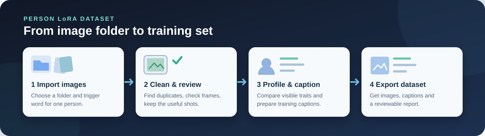

# DatasetCurator

**Turn a folder of person photos into a reviewable LoRA training dataset.** DatasetCurator is a local web app that helps you clean images, check identity consistency, build a person profile, and export images with training captions.

[Deutsch](README_DE.md) · [License](LICENSE) · [Caption pipeline](CAPTION_PIPELINE.md)



## What it does

- **Clean the image set:** detect unreadable files, near duplicates, and quality problems before image audit requests.
- **Remove screenshot frames:** get local crop suggestions, review similar layouts together, or mark an image for exclusion. Source images stay untouched. The local detector also finds inner photos in story screenshots, polaroid frames and chat views; an inner photo is always the first variant. The view can be set to **Not safely auto-cropped**, **More than one draft** or **All images**.
- **Select useful photos:** audit quality and identity, then keep a varied set of portraits, medium shots, and full-body images.
- **Build a Subject Profile:** find the person's usual appearance while keeping visible changes such as hair, glasses, piercings, and tattoos controllable.
- **Create training captions:** save first descriptions from Florence 2, JoyCaption, or GPT-6 Luna; caption rules and the person profile decide what goes into each final caption, which is written as whole sentences, locally or by GPT-6 Luna from the exported image and checked against the rules. Preview them before export.
- **Export for image LoRAs:** choose among nine image training targets, including ERNIE Image, Z-Image, Krea 2, Qwen-Image 2.1, FLUX.2, and experimental Ideogram 4.

The image workflow is the focus. An optional Video Processor can extract candidate photos from videos.

## Requirements

- **Python 3.13**.
- **OpenAI API key and available credit** for image audits, optional AI frame finding, and GPT-6 Luna captions. Local preflight and frame suggestions work without a key.
- **NVIDIA CUDA GPU** only if you want to run Florence 2 or JoyCaption locally. The main app and CPU installation do not require one.
- **InsightFace** is optional for image curation; ArcFace identity matching and Video Processor face matching need it.
- **MediaPipe models** for local face and pose detection (about 6 MB) are downloaded once on first use into `_models/`. Without them the frame detector still works but no longer checks crops against faces and bodies.
- **CLIP** for duplicate detection: without an NVIDIA GPU the tool automatically uses the fast ViT-B-32 model, with a GPU ViT-L-14. The choice is under *Audit & Selection → Duplicate detection*.

The Python package list is in [requirements.txt](requirements.txt).

## Install

### Windows

```powershell
git clone https://github.com/Arona1812/DatasetCurator.git
cd DatasetCurator
.\start_curator.bat
```

You can also double-click `start_curator.bat`. It creates a Python 3.13 environment, installs the app dependencies, and opens the interface. For an installation without CUDA packages, run `.\start_curator.bat --cpu`.

Florence 2 and JoyCaption need **separate local model weights and a CUDA GPU**; the launcher does not install those workers. See [local caption setup](CAPTION_PIPELINE.md#lokale-einrichtung). To start without them, select **GPT-6 Luna** for first descriptions in *Audit & Selection*. Luna sends those images to OpenAI and uses API credit.

### Linux or macOS

```bash
git clone https://github.com/Arona1812/DatasetCurator.git
cd DatasetCurator
python3.13 -m venv .venv
source .venv/bin/activate
python -m pip install --upgrade pip
python -m pip install -r requirements.txt
python dataset_curator_ui.py
```

The Windows launcher is the maintained setup path. The manual installation uses portable packages; optional InsightFace and GPU builds need platform-specific setup. See [installation notes](docs/INSTALLATION.md).

## Your first dataset

1. In **Start / Project**, choose the image folder, set a unique trigger word, and enter your API key.
2. Run **Preflight**. Review any suggested frame crops in **Frames**; you can keep the original or exclude a photo.
3. In **Audit & Selection**, choose a training target and first-caption model. Choose **Review profile first** to pause before export, or use the automatic profile decision.
4. Check the **Subject Profile** and caption preview, then export. Inspect the result under `curated_<trigger>/`.

`01_train_ready` contains the selected images and matching `.txt` captions. Other folders keep unused, review, and rejected images separate. The export also includes a report and target metadata. Your input folder is not overwritten.

## Before training

The nine targets are export choices, not nine proven LoRA recipes. ERNIE Image, Z-Image Base, and Krea 2 Raw have dedicated caption-field presets; the others currently start from general settings that you can change. Ideogram 4 uses an experimental JSON export. **Review the images and captions before training.** Training quality has not yet been measured across all targets.

For deeper use, see the [caption workflow](CAPTION_PIPELINE.md), [frame review guide](docs/FRAME_REVIEW.md), and [current project status](PROJECT_REVIEW.md).
For questions or problems, [open a GitHub issue](https://github.com/Arona1812/DatasetCurator/issues).

## Privacy and license

The app runs locally. Image audits and the optional Luna captioner send selected images to OpenAI; local preflight, frame suggestions, Florence 2, and JoyCaption run on your machine. API keys can be saved in ignored local settings files, so do not share those files.

The code is [MIT licensed](LICENSE). Dependencies and model weights have their own terms; see [third-party licenses](thirdparty-lic.md).
